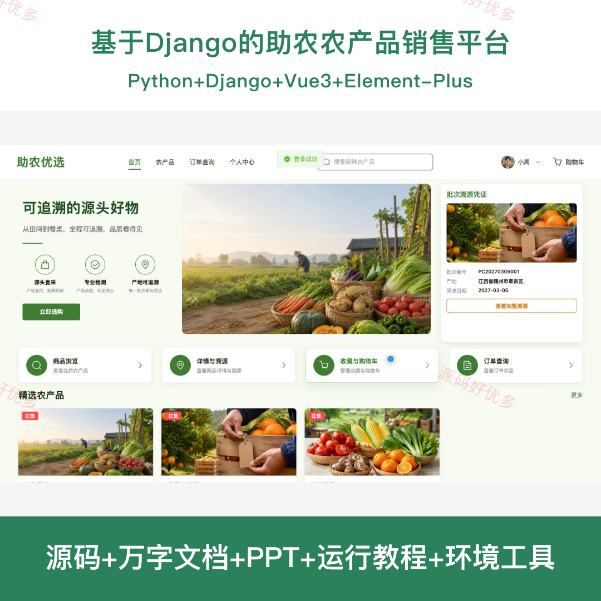
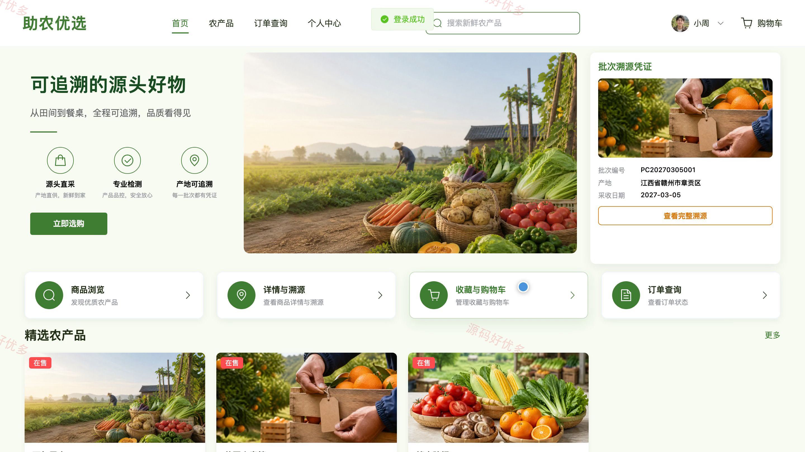
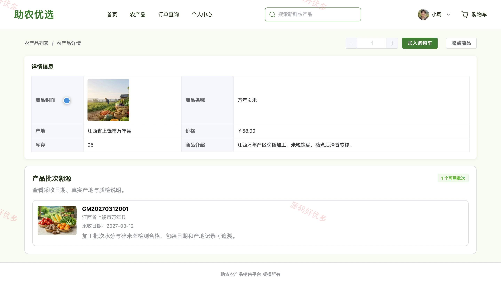
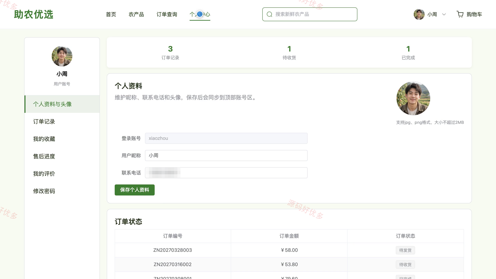
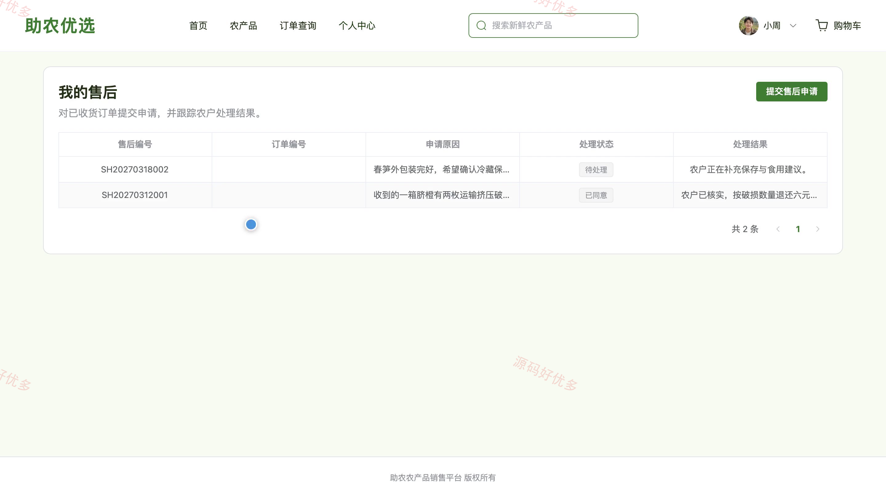
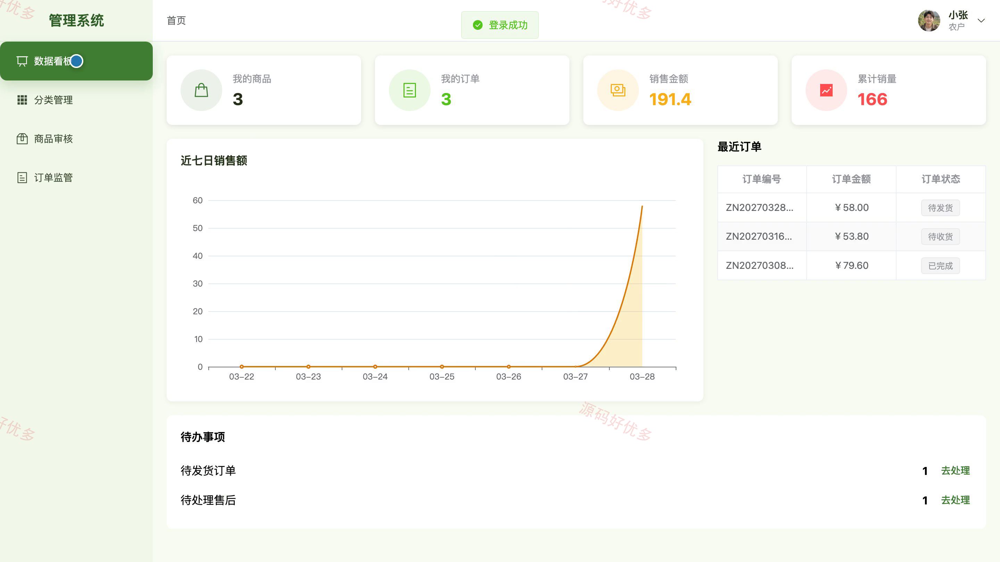
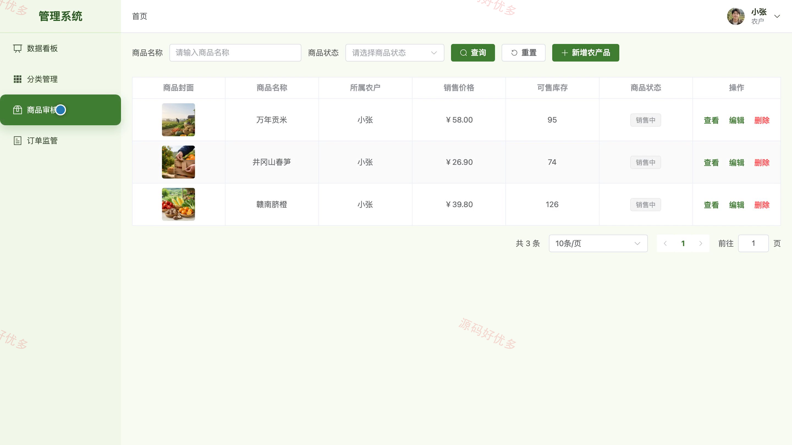
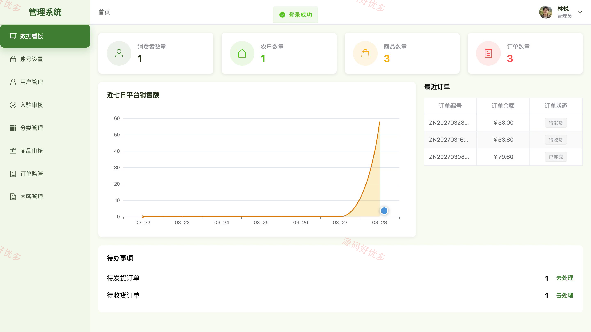
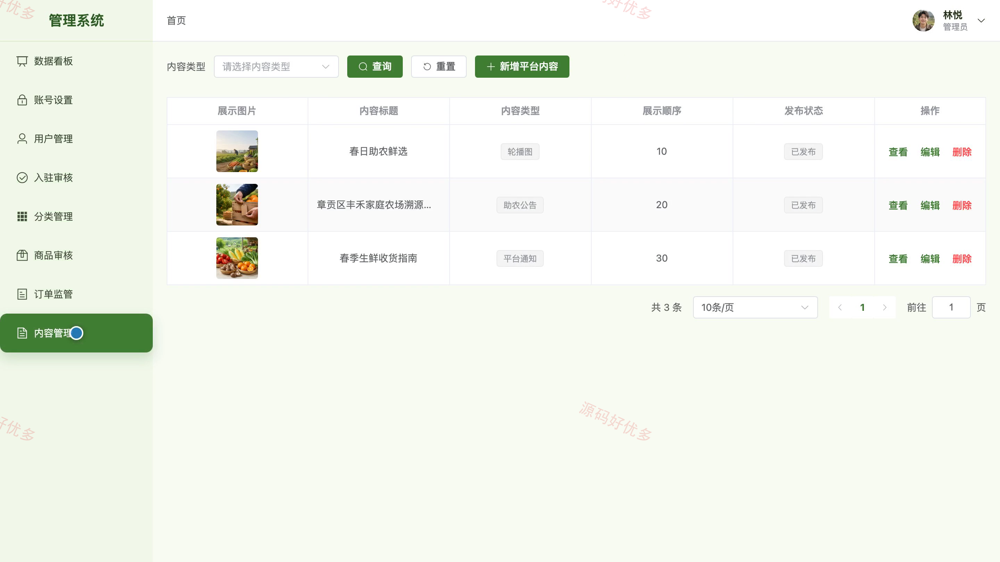

## 源码问题查看主页咨询

### 一、关键词
助农电商、农产品销售、产地溯源、农户入驻、生鲜订单

### 二、作品包含
源码+数据库+万字设计文档+PPT+全套环境和工具资源+本地部署教程

### 三、项目技术
前端技术： Html、Css、Js、Vue3.4、Element-Plus
后端技术：Python、Django

### 四、运行环境要求
开发工具：PyCharm + VSCODE

数据库：MySQL5.7+（共16张表）

数据库管理工具：Navicat10以上版本

环境配置软件： Python3.9+

前端Nodejs：16+

浏览器：谷歌浏览器

### 五、项目介绍
项目编号：bs119C

本系统面向助农农产品销售场景，为消费者提供商品浏览、购物车、订单、溯源、售后和评价服务；农户可维护入驻资料、商品与生产批次，并处理订单、售后及评价；管理员负责用户、农户资质、商品、订单和平台内容的统一管理。

角色：消费者、农户、管理员

消费者功能：农产品分类浏览与详情查看、商品收藏与购物车管理、收货地址维护、订单全流程管理、农产品溯源信息查看、售后申请与进度查看、商品评价、个人资料与密码维护。

农户功能：经营数据看板、入驻资料与资质维护、农产品发布与库存维护、商品分类管理、产品批次与溯源信息管理、订单查询与发货处理、售后申请处理、商品评价回复。

管理员功能：平台数据看板、用户账号与状态管理、农户入驻资质审核、商品审核与上下架管理、商品分类管理、订单监管、平台内容管理、个人资料与密码维护。

### 六、运行截图

